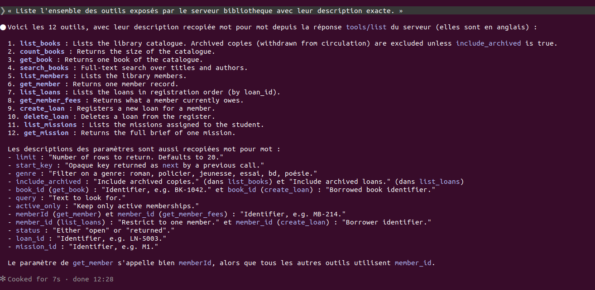
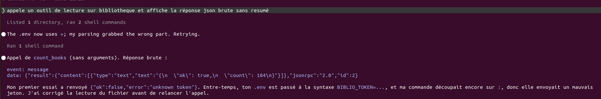

# TP1 — Faire parler une API que personne ne documente

## 0. Agent et gestion du token

- Agent utilisé : **Claude Code** (au lieu d'OpenCode).

- Le serveur est déclaré pour Claude Code dans `.mcp.json` (type `http`, header `Authorization: Bearer ${BIBLIO_TOKEN}`) : Claude Code remplace `${BIBLIO_TOKEN}` par la variable d'environnement au lancement, le token n'est donc pas dans le fichier.
- `opencode.json` référence le token par `{env:BIBLIO_TOKEN}` : il n'apparaît jamais en clair dans le fichier commité.
- Le token est stocké dans `.env` (`BIBLIO_TOKEN=...`), fichier listé dans `.gitignore`.
- Vérification de l'historique : `git log -p --all | grep -c <token>` → `0`.
- L'URL du serveur doit se terminer par `/mcp` : la racine (`/`) répond `404 Cannot POST /`.

## 1. Intégrer le serveur MCP

### 1.a — Outils exposés



Le serveur s'annonce `bibliotheque-municipale` v1.0.0 et expose 12 outils (descriptions exactes) :

| Outil | Description | Paramètres |
|---|---|---|
| `list_books` | Lists the library catalogue. Archived copies (withdrawn from circulation) are excluded unless `include_archived` is true. | `limit`, `start_key`, `genre`, `include_archived` |
| `count_books` | Returns the size of the catalogue. | — |
| `get_book` | Returns one book of the catalogue. | `book_id` |
| `search_books` | Full-text search over titles and authors. | `limit`, `start_key`, `query` |
| `list_members` | Lists the library members. | `limit`, `start_key`, `active_only` |
| `get_member` | Returns one member record. | `memberId` |
| `list_loans` | Lists the loans in registration order (by loan_id). | `limit`, `start_key`, `member_id`, `status`, `include_archived` |
| `get_member_fees` | Returns what a member currently owes. | `member_id` |
| `create_loan` | Registers a new loan for a member. | `member_id`, `book_id` |
| `delete_loan` | Deletes a loan from the register. | `loan_id` |
| `list_missions` | Lists the missions assigned to the student. | — |
| `get_mission` | Returns the full brief of one mission. | `mission_id` |

### 1.b — Appel d'un outil de lecture, réponse brute



```
>>> {"name": "count_books", "arguments": {}}
{"result":{"content":[{"type":"text","text":"{\n  \"ok\": true,\n  \"count\": 184\n}"}]},"jsonrpc":"2.0","id":2}
```

Première page de `list_books` (`limit: 50`) : voir `journal/m1_inventaire.txt`.

### 1.c — Énoncé exact des cinq missions (source : `get_mission`)

- **M1 — Inventaire** : « Le conseil municipal demande le nombre exact d'ouvrages détenus par la bibliothèque, et la répartition par genre. Donne les chiffres et explique comment tu les as obtenus. »
- **M2 — Le retardataire** : « Identifie l'emprunt le plus en retard actuellement : quel adhérent, quel ouvrage, et combien de jours de retard exactement. Donne aussi le montant dû par cet adhérent. »
- **M3 — La réinscription** : « Enregistre un nouvel emprunt pour l'adhérent MB-214 sur l'ouvrage BK-1042, puis vérifie que l'emprunt apparaît bien dans sa fiche. »
- **M4 — Le ménage** : « L'adhérent MB-202 demande l'effacement de ses emprunts déjà rendus. Supprime-les, puis prouve qu'ils ont bien disparu. »
- **M5 — La relance** : « Prépare la campagne de relance : la liste des adhérents ayant au moins un emprunt en retard et joignables par mail, et le nombre de ceux qui ne sont pas joignables, en distinguant les cas. »

## 2. Journal de bord des cinq missions

Les réponses brutes complètes (requête + réponse JSON-RPC) sont dans `journal/`.

### M1 — Inventaire

| Tentative | Appel | Réponse brute (extrait) | Conclusion de l'agent | Ce qui clochait |
|---|---|---|---|---|
| 1 | `count_books {}` | `"count": 184` | 184 ouvrages | `count_books` inclut les archivés (cf. tentative 3) |
| 2 | `list_books {limit:50}` en suivant `next` jusqu'à `null` | pages pleines, puis `{"items":[],"next":"MjUw"}` à l'infini | « 158 ouvrages », puis « le serveur ignore `limit` » | `next` n'est jamais `null` → boucle infinie ; le serveur s'est mis à renvoyer des données vides (`count: 0`, listes vides) : quota silencieux. L'affirmation sur `limit` était **fausse**. |
| 3 | `list_books {limit:50}` et `{limit:50, include_archived:true}`, arrêt à la 1re page vide | 158 actifs / 184 au total, 0 doublon | voir ci-dessous | — |

**Réponse retenue (3 tentatives)** : la bibliothèque détient **158 ouvrages (titres) actifs, soit 415 exemplaires** ; 26 titres (75 exemplaires) archivés sont exclus. `count_books` (184) = actifs + archivés.

| Genre | Titres | Exemplaires |
|---|---|---|
| roman | 30 | 71 |
| jeunesse | 30 | 82 |
| poésie | 29 | 70 |
| policier | 27 | 79 |
| essai | 23 | 65 |
| bd | 19 | 48 |
| **Total** | **158** | **415** |

### M2 — Le retardataire

| Tentative | Appel | Réponse brute (extrait) | Conclusion de l'agent | Ce qui clochait |
|---|---|---|---|---|
| 1 | `list_loans {limit:50}` paginé, prêts `open` triés par `due_at` | `LN-5106`, `MB-225`, `BK-1075`, `due_at: 1775811600` | 180 jours de retard (horloge réelle 07/10) | La date de référence du serveur est le 06/10 09:00 (cf. M3) |
| 2 | `get_member_fees` pour les 46 membres à la suite | 2 réponses correctes puis `{"ok":true,"member_id":null,"balance_due":0}` | — | Quota silencieux : un agent naïf conclurait « 0 € dû » |
| 3 | idem, 1,5 s entre appels, rejeu si `member_id` ≠ demandé | `{"open_loans":1,"overdue_duration":4296,"late_fee_per_day":15,"balance_due":26.85}` | voir ci-dessous | `overdue_duration` en heures, `late_fee_per_day` en centimes, `balance_due` en euros |

**Réponse retenue (3 tentatives)** : prêt **LN-5106**, adhérent **MB-225 Paul Blanc**, ouvrage **BK-1075 « Le Retour des autres » (Yanis Perrin)**, échéance le 10/04/2026 → **179 jours de retard** à la date de référence du serveur (2026-10-06 09:00 UTC ; 180 jours si l'on compte jusqu'au 07/10). Montant dû par MB-225 : **26,85 €** (179 j × 0,15 €). Recoupement : `overdue_duration` 4296 h / 24 = 179 j, cohérent sur les 46 membres.

### M3 — La réinscription

| Tentative | Appel | Réponse brute | Conclusion de l'agent | Ce qui clochait |
|---|---|---|---|---|
| 1 | `create_loan {member_id:"MB-214", book_id:"BK-1042"}` | `{"ok":false,"error":"missing field"}` | — | Champ requis non documenté, non nommé |
| 2 | `create_loan {member_id:"MB-214", book_id:"BK-1042", desk_code:"A1"}` | `{"ok":true,"loan":{"loan_id":"LN-5137",...,"started_at":1791277200,"due_at":1793091600,"status":"open","desk_code":"A1"}}` | prêt créé | `started_at` = 06/10 09:00 alors que l'appel a eu lieu le 07/10 |
| vérif. | `list_loans {member_id:"MB-214", status:"open"}` | contient `LN-5036` et `LN-5137` | présent | — |
| vérif. | `get_member_fees {member_id:"MB-214"}` | `open_loans: 2` (avant : 1) | recoupé | `get_member` ne montre pas les prêts |

**Réponse retenue (2 tentatives)** : prêt **LN-5137** créé (MB-214 / BK-1042, guichet A1, du 06/10 au 27/10/2026, 21 jours = `loan_duration` du livre), visible dans `list_loans` et compté par `get_member_fees`.

### M4 — Le ménage

État initial (`list_loans {member_id:"MB-202", include_archived:true}`) : 7 prêts, dont 1 ouvert (`LN-5060`, à conserver) et 6 rendus : `LN-5038`, `LN-5039`, `LN-5062`, `LN-5095`, `LN-5120`, `LN-5134`. Aucun prêt archivé. Aucun de ces retours n'a de date dans le futur.

| Tentative | Appel | Réponse brute (extrait) | Conclusion de l'agent | Ce qui clochait |
|---|---|---|---|---|
| 1 | `delete_loan {loan_id:"LN-5038"}` | `{"ok":true,"deleted":true,"loan_id":"LN-5038"}` | supprimé | `list_loans {member_id:"MB-202", include_archived:true}` renvoie toujours LN-5038 avec `"archived": true` : suppression logique |
| 2 | `delete_loan {loan_id:"LN-5038"}` (rejoué) | `{"ok":true,"deleted":true,...}` | — | Rien ne change : pas d'effacement définitif possible |
| 3 | `delete_loan` sur LN-5039, LN-5062, LN-5095, LN-5120, LN-5134 | `"deleted": true` ×5 | — | idem |
| vérif. | `list_loans {member_id:"MB-202"}` | seul `LN-5060` (open) | prêts rendus disparus de la vue par défaut | preuve trompeuse à elle seule |
| vérif. | `list_loans {member_id:"MB-202", include_archived:true}` | les 6 prêts rendus, tous `"archived": true` | ils existent toujours | — |
| contrôle | `delete_loan {loan_id:"LN-9999"}` | `{"ok":false,"error":"not found"}` | l'outil sait signaler une erreur… mais pas que la suppression est logique | — |

**Réponse retenue (3 tentatives)** : les 6 emprunts rendus de MB-202 (LN-5038, LN-5039, LN-5062, LN-5095, LN-5120, LN-5134) ont été « supprimés » au sens de l'API : ils n'apparaissent plus dans `list_loans` par défaut ni avec `status:"returned"`. **Mais ils ne sont pas effacés** : le serveur les a seulement archivés, et `include_archived:true` les renvoie toujours. Aucun outil ne permet l'effacement réel demandé par l'adhérent ; il faut le signaler à la médiathèque. Le prêt en cours LN-5060 a été conservé (`get_member_fees` : `open_loans: 1`, 17,25 €).

### M5 — La relance

| Tentative | Appel | Conclusion | Ce qui clochait |
|---|---|---|---|
| 1 | `list_loans` paginé (prêts `open`, `due_at` < date serveur) + `list_members` paginé ; `get_member` sur les non-joignables pour recouper | 29 adhérents en retard (49 prêts) | Deux formes d'absence d'email (clé absente / `null`), un membre inactif, adresses partagées |

**Réponse retenue (1 tentative)** :

Joignables par mail (21 fiches, 20 adresses distinctes) :

| Adhérent | Nom | Email | Prêts en retard |
|---|---|---|---|
| MB-200 | Yanis Robin | yanis.robin@example.org | 1 |
| MB-201 | Mehdi Moreau | mehdi.moreau@example.org | 1 |
| MB-202 | Nora Noël | nora.noel@example.org | 1 |
| MB-204 | Léa Guerin | lea.guerin@example.org | 1 |
| MB-207 | Mehdi Blanc | mehdi.blanc@example.org | 1 |
| MB-208 | Paul Leroy | paul.leroy@example.org | 1 |
| MB-210 | Lucas Blanc | lucas.blanc@example.org | 4 |
| MB-214 | Chloé Roux | chloe.roux@example.org | 1 |
| MB-216 | Thomas Dumas | thomas.dumas@example.org | 2 |
| MB-217 | Hugo Barbier | hugo.barbier@example.org | 1 |
| MB-221 | Paul Dumas | paul.dumas@example.org | 3 |
| MB-225 | Paul Blanc | paul.blanc@example.org | 1 |
| MB-227 | Hugo Perrin | hugo.perrin@example.org | 1 |
| MB-228 | Lucas Fontaine | lucas.fontaine@example.org | 2 |
| MB-230 | Nora Roux | nora.roux@example.org | 2 |
| MB-231 | Karim Guerin | karim.guerin@example.org | 1 |
| MB-237 | Yanis Robin | yanis.robin@example.org (même adresse que MB-200) | 2 |
| MB-239 | Sarah Perrin | sarah.perrin@example.org | 5 |
| MB-240 | Léa Perrin | lea.perrin@example.org | 1 |
| MB-242 | Paul Guerin | paul.guerin@example.org | 2 |
| MB-219 | Sarah Guerin — **adhésion inactive** | sarah.guerin@example.org | 2 |

Non joignables : **8**
- `email: null` (5) : MB-203, MB-212, MB-226, MB-232, MB-234
- clé `email` absente de la fiche (3) : MB-206, MB-235, MB-241

### 2.a — Récapitulatif

| Mission | Réponse retenue | Tentatives |
|---|---|---|
| M1 | 158 titres / 415 exemplaires actifs (détail par genre ci-dessus) | 3 |
| M2 | LN-5106, MB-225 Paul Blanc, BK-1075, 179 j, 26,85 € | 3 |
| M3 | LN-5137 créé et vérifié | 2 |
| M4 | 6 prêts rendus « supprimés » = archivés (masqués, pas effacés) ; LN-5060 conservé | 3 |
| M5 | 21 fiches joignables (20 adresses), 8 non joignables (5 null + 3 absents) | 1 |

### 2.b — L'agent satisfait d'un résultat faux

*Capture à ajouter.* Lors de la tentative 2 de M1, l'agent a suivi `next` sans fin ; il a ensuite affirmé que « le serveur ignore `limit` », ce qui était faux, et sa requête `include_archived: true` a renvoyé `{"ok":true,"items":[],"next":null}`, qu'il aurait pu prendre pour « 0 archivé ». De même en M2, la tentative 2 renvoyait `balance_due: 0` pour 44 membres sur 46, réponses `ok: true` mais fausses (quota). Preuves : `journal/m1_inventaire.txt`, `journal/m2_fees_degrade.txt`.

## 3. Le skill

Emplacement : `.claude/skills/bibliotheque-mcp/SKILL.md` (format Agent Skills de Claude Code : frontmatter `name` + `description`, `name` = nom du dossier ; Claude Code le charge automatiquement quand la `description` correspond à la tâche).

### 3.1 — Outil utilisé pour l'écrire

*À compléter.*

### 3.3 — La preuve

- a. *Captures avant / après à ajouter.*
- b. *Capture du chargement du skill par Claude Code à ajouter.*
- c. Un skill est chargé par l'agent lui-même dès qu'il reconnaît la situation (ici : tout appel au serveur `bibliotheque`), grâce à sa `description`. Une command, elle, n'existe que si l'humain la tape. À l'usage, les règles s'appliquent donc sans qu'on y pense, même au milieu d'une autre tâche, et ne coûtent du contexte qu'au moment où elles servent.
